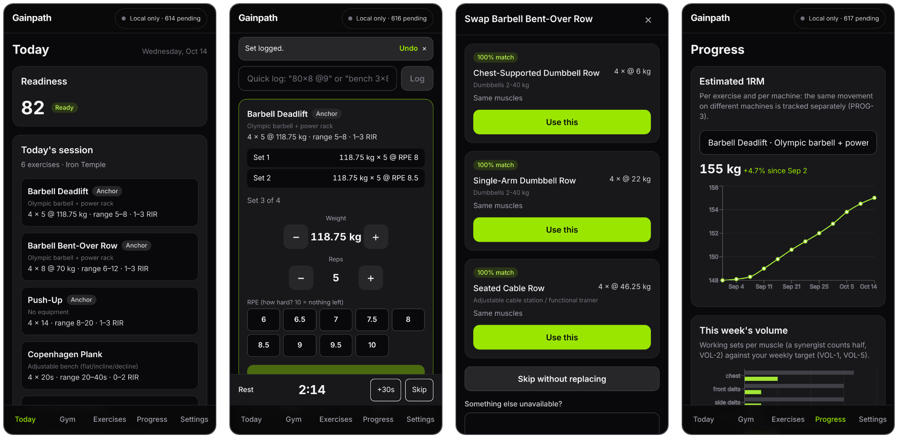
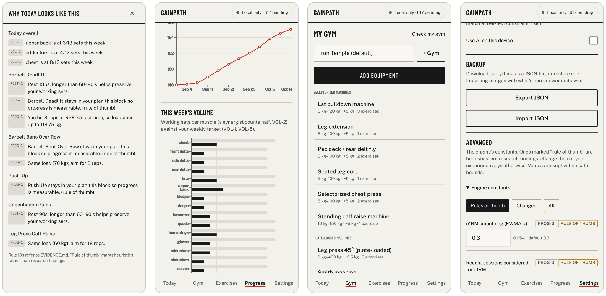

# Gainpath

A strength-training app that builds each session from your readiness, the volume you've done
this week and the machines in your gym, then adjusts set by set from the RPE you log.

It runs on your phone and works offline. Training needs no AI: sessions, loads, swaps and
explanations come from a deterministic engine. Every rule it uses is graded against the
research in [EVIDENCE.md](EVIDENCE.md) and specified in [ALGORITHMS.md](ALGORITHMS.md).




Screenshots are from the app running six weeks of history generated by the engine
(`pnpm demo:data`, `pnpm screenshots`).

## Features

- Daily check-in (sleep, energy, soreness) sets readiness; wearable HRV and resting HR are
  optional soft inputs.
- Sessions fill each muscle's weekly target, respect recovery and fit your session length.
- Loads come from your estimated 1RM per exercise per machine, rounded to what the machine can do.
- In-session adjustment: a set harder than planned lowers the next set's load.
- Swaps by reason (busy, broken, pain, …), ranked by muscle match, including two-exercise combos.
- One-line logging (`3x8 @ 80`), warm-ups, rest timer, periodic RIR calibration sets.
- Progress: e1RM trends, weekly volume against target, per-muscle recovery.
- Optional: cloud sync (Supabase), AI for machine photos and free text (Anthropic),
  Google Health.

## Run it

Requires Node 20.9+ and pnpm 10.

```bash
pnpm install
pnpm dev        # http://localhost:3000
```

No configuration is needed; data stays on the device. To load sample data, use
Settings → Import JSON with [`docs/screenshots/demo-backup.json`](docs/screenshots/demo-backup.json).

| Command                             | Purpose                                        |
| ----------------------------------- | ---------------------------------------------- |
| `pnpm test`                         | Unit tests                                     |
| `pnpm test:e2e`                     | End-to-end tests (Playwright)                  |
| `pnpm lint`, `pnpm typecheck`       | Static checks                                  |
| `pnpm build`, `pnpm start`          | Production build, including the service worker |
| `pnpm preview:cf`, `pnpm deploy:cf` | Run or deploy the Cloudflare Workers build     |

## Evidence

Grades: A = meta-analysis or systematic review, B = individual studies or preprints,
C = consensus, H = heuristic. The app labels H rules as rules of thumb.

| Rule     | Grade | Finding                                                                    | Source                                  | Used for                               |
| -------- | :---: | -------------------------------------------------------------------------- | --------------------------------------- | -------------------------------------- |
| PHIL-1   |   A   | Consistency matters most; train each muscle at least twice a week          | ACSM position stand, 2026               | Minimum weekly frequency per muscle    |
| LOAD-1   |   A   | Heavy loads suit strength; a wide rep range builds muscle near failure     | Currier et al., _BJSM_ 2023             | Rep ranges by goal                     |
| VOL-1    |   A   | More weekly sets give more gains, with diminishing returns                 | Pelland et al., _Sports Med_ 2026       | Weekly set targets                     |
| VOL-2    |   A   | Count sets fractionally: prime mover 1, synergist 0.5                      | Pelland et al., _Sports Med_ 2026       | Muscle vectors for every exercise      |
| VOL-4    |   B   | Per-session volume plateaus around 11 sets per muscle                      | Remmert et al., SportRxiv (preprint)    | Session cap per muscle                 |
| EFF-1    |   A   | Hypertrophy improves closer to failure; strength depends on it less        | Robinson et al., _Sports Med_ 2024      | Target reps in reserve                 |
| EFF-2    |   B   | Training to failure slows recovery                                         | Morán-Navarro et al., _EJAP_ 2017       | Fatigue weighting                      |
| EFF-3    |   A   | RPE maps to reps in reserve; estimates are off by about one rep            | Zourdos 2016; Halperin 2022             | RPE logging and calibration            |
| PROG-1   |   A   | RPE-based autoregulation is at least as good as percentage programs        | Hickmott et al., _Sports Med Open_ 2022 | Progression and in-session adjustment  |
| PROG-3   |   B   | 1RM equations are reliable up to about 10 reps                             | LeSuer 1997; Reynolds 2006              | e1RM estimation                        |
| REST-1   |   A   | Rest over 60 s helps hypertrophy, with little gain beyond 90 s             | Singer et al., 2024                     | Rest times                             |
| READY-1  |   A   | Six hours of sleep or less impairs performance                             | Craven et al., _Sports Med_ 2022        | Volume reduction after short sleep     |
| READY-2  |  A/C  | HRV guidance helps endurance training; no evidence for resistance training | Granero-Gallegos 2020; Düking 2021      | HRV as a soft modifier only            |
| DELOAD-2 |   B   | A week of no training didn't help hypertrophy and hurt strength            | Coleman et al., _PeerJ_ 2024            | Deloads reduce volume rather than stop |

Full rules and references: [EVIDENCE.md](EVIDENCE.md).

## Core formulas

Constants live in [`src/engine/config.ts`](src/engine/config.ts) and can be changed in
Settings → Advanced. The full engine is described in [ALGORITHMS.md](ALGORITHMS.md).

**Estimated 1RM** (Epley, with reps in reserve and a personal calibration offset $c$),
from sets of at most 10 reps at RPE 6 or higher:

```math
\widehat{1\mathrm{RM}} = w\left(1 + \frac{r + (10 - \mathrm{RPE}) + c}{30}\right),
\qquad E_t = 0.7\,E_{t-1} + 0.3\,B_t
```

$B_t$ is the session's best set; a jump above 10% is capped at +5%.

**Prescribed load** for target reps $r^_$ and reps in reserve $\mathrm{RIR}^_$, rounded down to
an available weight:

```math
w^* = \frac{E}{1 + (r^* + \mathrm{RIR}^*)/30}
```

**Readiness**, where $q$ are 1–5 check-in ratings and $\tilde z$ are wearable deviations from your
14-day baseline, clamped to ±2:

```math
S = 70 + 6(q_\text{sleep} - 3) + 6(q_\text{energy} - 3) - 10\,[h_\text{sleep} \le 6] + 4\tilde z_\text{HRV} - 3\tilde z_\text{RHR}
```

**Muscle fatigue**, decaying with half-life $\tau_m$ (24 h small, 36 h large muscles), where
$v_{i,m}$ is the muscle's share of the exercise, $\phi$ an effort weight (0.7–1.5) and $s_m$
today's soreness:

```math
F_m(t) = \sum_i v_{i,m}\,\phi(\mathrm{RPE}_i)\,2^{-(t - t_i)/\tau_m} + 1.5\,s_m,
\qquad \text{recovery}_m = 1 - \min(F_m / 8,\ 1)
```

**Today's volume per muscle**, from the weekly target $T_m$ and what's been done in the last 7 days:

```math
N_m = \min\left(\frac{\max(0,\ T_m - \textstyle\sum v_{i,m})}{\text{sessions left}} \cdot k_\text{readiness},\ 10\right)
```

**Swap match**: cosine similarity between the remaining work $\mathbf{t}$ and a candidate's
muscle vector:

```math
\text{match}(e) = \frac{\mathbf{t} \cdot \mathbf{v}_e}{\lVert \mathbf{t} \rVert\,\lVert \mathbf{v}_e \rVert}
```

## Deploy

Free hosting: Cloudflare Workers for the app, Supabase for sign-in and sync.

1. **Supabase** (optional): create a project, run the files in
   [`supabase/migrations/`](supabase/migrations) in order, and add
   `https://<your-app>/auth/callback` to Authentication → URL Configuration → Redirect URLs.
2. **Cloudflare**: Workers & Pages → Create → Import a repository. Build command
   `pnpm exec opennextjs-cloudflare build`, deploy command `pnpm exec opennextjs-cloudflare deploy`.
   Add the environment variables below; add the `NEXT_PUBLIC_*` ones as build variables too.
3. **Phone**: open the URL once, then "Install app" (Android) or "Add to Home Screen" (iOS).

| Variable                                                                          | Enables                        |
| --------------------------------------------------------------------------------- | ------------------------------ |
| `NEXT_PUBLIC_SUPABASE_URL`, `NEXT_PUBLIC_SUPABASE_PUBLISHABLE_KEY`                | Sign-in and sync               |
| `ANTHROPIC_API_KEY`, `AI_DAILY_LIMIT` (default 20)                                | AI features, opt-in per device |
| `AI_MODEL_FAST`, `AI_MODEL_DEEP`                                                  | Model overrides                |
| `GOOGLE_HEALTH_ENABLED`, `GOOGLE_HEALTH_CLIENT_ID`, `GOOGLE_HEALTH_CLIENT_SECRET` | Google Health sync             |

Running one copy for friends who pay for an account: [hosted, invite-only](docs/hosted.md).

More detail: [Google Health](docs/google-health.md), [Samsung Health](docs/samsung-health.md),
[architecture and sync](PLAN.md).
